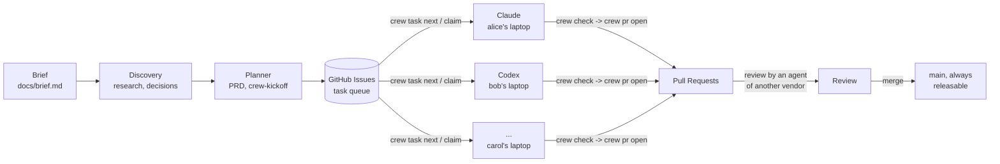

**English** | [Русский](README.ru.md)

# agent-crew

**A vendor-neutral development environment where several coding agents (Claude Code, Codex, more through adapters) and humans work as one team on any project, coordinated through GitHub Issues and Pull Requests.**

People write clear tasks, agents on the team members' own machines take them from a shared queue, write the code, check it and hand it in for review, and the tool makes sure they do not step on each other, do not break `main` and follow one set of rules, whether the agent is Claude or GPT. It was battle-tested at a 4-person hackathon (10-13 Nov 2026, about 200 merged PRs in the public repo [employee-feedback](https://github.com/GredesCerber/employee-feedback), run with its predecessor `hk`); the hackathon features are an optional [event mode](#event-mode).

---

## Why

When several agents (and people) share one repository, the same problems show up every time:

- two agents take the same task, or a crashed agent leaves a task stuck forever;
- nobody reviews the code agents write, or an agent approves its own work;
- an agent "turns CI green" by weakening a test or editing the CI config;
- every vendor has its own instruction files, so the rules drift apart;
- `main` is broken at the moment you need it working.

agent-crew answers with a small protocol on top of GitHub, enforced by code and CI rather than by prose.

## What it consists of

| Part | What it is | Why |
|---|---|---|
| **Rules** | `AGENTS.md`, roles, skills | Like a handbook for a new employee: what to do, when to stop, what is forbidden |
| **The `crew` control CLI** | a small dependency-free Node.js program (also an MCP server) | Take a task, check code, hand in work: the same for every agent |
| **Checks** | GitHub Actions, templates, branch protection | An agent may ignore text, but cannot bypass CI |

Everything lives in **GitHub**: Issues are the task queue, Pull Requests are the hand-in, Actions are the checks. There is no separate server. Agents run **on the team members' machines, on their own subscriptions**.

**Language rule:** everything written to GitHub (issues, PRs, commits, comments) and everything agents write to each other is English. Agents talk to each human in that human's language.

## How it works



The life of one task:

```
needs-spec ──(human adds criteria)──► ready ──(crew task claim)──► claimed ──(crew pr open)──► review ──► done
                                        ▲                             │
                                        └──── lease expired / ────────┘
                                              crew task release
```

## Quick start

**Fastest: one message to an agent.** The agent reads [docs/AGENT-SETUP.md](docs/AGENT-SETUP.md) and sets everything up itself. Ready-to-paste messages for the captain, a member and the plan are at the end of that file. The commands behind them:

```bash
# captain: first look (changes nothing), then create the project, the GitHub repo, invitations and protection of main
crew up --repo owner/name --public --check
crew up --repo owner/name --public --invite alice,bob

# member: accept the invitation, clone, build local agent configs
crew up --join owner/name
```

What stays manual, because an agent must not or cannot do it: logging in (`gh auth login`, Claude, Codex) and confirming project trust in Codex.

**Private repo on the free GitHub plan?** GitHub does not protect `main` there, so PR rules and checks bind nobody. `crew up` checks the plan before it writes anything and stops with `preflight` unless you pass `--public`, have a paid plan, or say `--no_protection` knowingly. Already have a repo? [Try crew on one issue](docs/PILOT.md) first: `crew github setup` keeps the required checks and review rules your `main` already has.

### 1. Install (once per machine)

Needs Node.js 22+, git, the [GitHub CLI](https://cli.github.com/) (`gh auth login`) and at least one agent: [Claude Code](https://code.claude.com) or [Codex CLI](https://github.com/openai/codex).

The tool installs from the public npm registry (no tokens):

```bash
npm install -g @gredescerber/agent-crew
```

The command is `crew`. Straight from GitHub instead: `npm install -g --allow-git=all github:GredesCerber/agent-crew#vX.Y.Z` (the tag of the release you want) (npm 12+ blocks git installs without the flag).

Or clone it and link it (no dependencies; `npm link` only puts `crew` on PATH):

```bash
gh repo clone GredesCerber/agent-crew && cd agent-crew && npm link
```

```bash
crew doctor
```

`crew doctor` shows what is missing.

**Windows:** if PowerShell refuses to run `crew` ("running scripts is disabled on this system"), call `crew.cmd` instead (same for `npm.cmd`); no policy change needed. Run crew from the project folder: in PowerShell `cd D:\path\to\project` (cmd needs `cd /d`).

**Windows:** enable long paths in git, otherwise it fails on task worktrees and `node_modules`:

```bash
git config --global core.longpaths true
```

### 2. Create the project (captain)

```bash
crew up my-product --repo owner/my-product --stack web-node --invite alice,bob --public
```

`crew up` runs `crew init`, makes the first commit, creates the GitHub repo and pushes, invites the members, and sets up `main` protection, labels and `CREW_HARNESS`. It is safe to re-run: finished steps are skipped. Add `--hosts claude,codex` to choose agent hosts.

Or step by step:

```bash
crew init my-product --stack web-fastapi
cd my-product && git add -A && git commit -m "chore: crew init"
gh repo create owner/my-product --public --source . --push
crew github setup --apply
```

What appears in `my-product/`:

```
AGENTS.md                ← the main rules for all agents
CLAUDE.md                ← one line: @AGENTS.md (Claude reads the rules from there)
crew.config.json         ← areas, checks, model tiers, MCP
agents/roles/            ← analyst, planner, builder, reviewer, integrator + helpers scout, implementer
agents/skills/           ← crew-workflow, crew-kickoff, crew-review, crew-brief-analysis, crew-discovery
.claude/ .mcp.json       ← generated for Claude Code (+ the ECC plugin)
.codex/ .agents/skills/  ← generated for Codex
.github/                 ← issue and PR templates, CI checks (crew.yml) and PR rules (crew-guard.yml)
contracts/ tests/ docs/  ← API contracts, acceptance tests, brief, discovery.md, decisions.md, playbooks
README.md JOIN.md        ← the first line tells a newcomer what to say to their agent; JOIN.md is for that agent
events/                  ← optional event rules (time window, team members)
```

Stack presets: `web-fastapi` (React + FastAPI) and `web-node` (React + Node.js). A preset is **not ready-made code** but a list of generators (`npm create vite`, `uv init`) and checks; the agent creates the skeleton itself.

### 3. Set up the GitHub repo (`crew github setup`)

One command instead of clicking through Settings (needs admin rights on the repo):

```bash
crew github setup           # show the plan of gh api calls, change nothing
crew github setup --apply   # do it
```

With `--apply` it:

- protects `main`: PRs only, green `check` (tests) and `crew-guard` (PR rules + agent review) required, no force-push. **Zero manual approvals**: a human is not an "approve button";
- enables auto-merge and plain merge commits only (squash and rebase are off because they lose the `Agent`/`Issue` trailers);
- sets the `CREW_HARNESS` repo variable: the install spec CI uses, by default `@gredescerber/agent-crew@<version>` (another one via `--harness`);
- creates or updates all labels (like `crew labels sync`).

Re-running is safe. The repo is taken from the current folder (`gh repo view`) or from `--repo owner/name`; another branch via `--branch`.

> **Branch protection needs a public repo or GitHub Pro/Team.** On the free plan a private repo cannot protect `main`, and `crew github setup --apply` fails with HTTP 403.

### 4. Join an existing project (members)

**The easy way:** once the captain added you to the repo, tell your agent, in any language: **"Join the development of owner/name"**. The project's README points it to `JOIN.md`, which walks it through the machine check, the crew version the repo pins (`CREW_HARNESS`), `crew up --join` and the first task. You only log in to GitHub when it asks; no restart is needed. By hand it is one command:

```bash
crew up --join owner/name
```

This accepts the invitation, clones the repo, configures git and runs `crew adapters build`, which creates the local agent configs (`.mcp.json`, `.codex/config.toml`, skills, roles). They depend on the machine and are not committed; `crew task claim` copies them into each task worktree.

An agent's name in tasks and commits is `CREW_AGENT` plus the machine name (`claude@alice-laptop`), added by `crew`. A second session on the same machine gets its own name automatically from the crew MCP server (`claude@alice-laptop#2`); the two count as one agent for review, so neither can approve the other. In a terminal outside your task folder, with several sessions running, crew asks you to use the MCP tools instead of guessing (`ambiguous_agent`).

### 5. Discovery: research before the plan (captain and everyone)

A new team project starts in the **discovery phase** (`crew.config.json` → `"phase": "discovery"`): no product code yet; crew-guard lets PRs touch only `docs/`, `spikes/`, `README.md` and `JOIN.md` (spikes are throwaway experiments that never become product code). The captain's agent lists the open questions of the brief as `crew-research` blocks in `docs/discovery.md`; `crew discover plan --apply` makes them research tasks for the area owners. Each ends with a document: facts with sources, assumptions marked, a position. Disagreements go through PR comments and `crew ask`, questions for the organizers through `crew ask --human`, agreed decisions into `docs/decisions.md`. The PRD is written from all that, as a PR reviewed by another vendor's agent. `crew discover status` lists what is left; `crew kickoff --apply` waits for it and switches the phase to `build` (skill `crew-discovery`).

### 6. Plan: brief -> PRD -> tasks (captain)

The captain puts the brief into `docs/brief.md`, and the planner agent turns it into `docs/prd.md` (skills `crew-brief-analysis` and `crew-kickoff`). The PRD contains a `crew-team` block (who owns which area, who reviews) and `crew-task` / `crew-epic` blocks. Then:

```bash
crew task lint            # validate the PRD offline
crew kickoff              # dry run: what would be created
crew kickoff --apply      # create the issues, once the PRD is approved
```

Details in [crew kickoff](#crew-kickoff).

### 7. Run the agents

**Claude Code**: open the project folder; it reads `CLAUDE.md` -> `AGENTS.md` and connects the `crew` MCP server on its own. Then:

> /loop 10m Work the crew-workflow loop

**Codex**: run `codex` in the project root and confirm you trust the project (otherwise it will not read `.codex/config.toml`, which also gives its terminal commands `CREW_AGENT=codex`). Codex has no `/loop`, so the loop runs in the chat on top of `crew task next --wait`:

> Work the crew-workflow loop without stopping: run `crew task next --wait 20`, do what its next_actions say, then run it again. Stop after three "no free tasks" answers in a row.

Members never plan; only the captain runs `crew kickoff`.

### Solo: one person, one agent

`crew init <dir> --solo` (or `crew up ... --solo`) keeps the useful part and drops the team machinery: no discovery gate, no second agent to review (`review.approvals: 0`), one host (Claude unless `--hosts`), no captain handover. CI checks, the protected-file and acceptance-test rules of crew-guard and the protected `main` stay; a PR merges once they are green, and `risk:high` still waits for you. Tasks are issues with Given/When/Then criteria (`crew task status <n> ready`) or a PRD with `crew kickoff`.

## Concepts

### Tasks and leases
A task is a GitHub issue with `status:*`, `area:*`, `tier:*` and `risk:*` labels. `crew task claim <id>` takes it: the label changes, a lease marker is written to a comment, the branch `crew/<id>-...` and a separate worktree are created. The lease lasts 45 minutes and is extended by activity (`crew task heartbeat`, crew markers in the issue, or a push to the `crew/<id>-*` branch). If an agent dies, the task returns to the queue by itself (a GitHub Action sweeps every 15 minutes). `crew task cleanup` removes worktrees of closed tasks that have no uncommitted changes and whose work is already saved in `main` or on GitHub.

### Areas and owners
Every task belongs to exactly one area (`web`, `api`, `infra`, ...). The `crew-team` block of the PRD maps areas to people:

````
```crew-team
alice: web, review   # frontend + reviewer
bob: api
```
````

`crew task next` offers a person's agent its own tasks first, then unowned ones, then other people's areas ("help the owner"). The `review` role marks the team's reviewers.

### Review-first queue
`crew task next` serves the team before itself: your own PR that needs fixes, then a question another agent asked you, then an answer to your question, then your own unfinished task on this machine (`resume`, after a session died), then a ready PR to merge, then a PR waiting for your review, and only then a new task. This keeps work from piling up behind review.

### The captain, and handing the role over
Whoever runs `crew up` is the captain (`crew.config.json` → `captain`): the only one who plans (`crew kickoff --apply`, `crew discover plan --apply`), decides on ideas and gets questions that need a human. The repo owner chooses at `crew up` whether the role can be handed over: `--handover off` (default), `deputies` (only to `--deputies`), `team` (anyone with write access), plus an optional automatic fallback to the first deputy after `--fallback_hours` of captain silence. The captain hands over with `crew captain handoff @login --hours N` and takes it back with `crew captain back`; `crew captain` shows who acts now. The rule changes later with `crew captain policy`.

### Ideas and questions
When a person suggests something outside the current task, the agent does not build it: `crew idea` records it for the captain, who accepts it as a `needs-spec` task (`crew idea accept`) or rejects it with a reason. When an agent needs something from another area, it asks the owner with `crew ask <area>`; the answer comes back through `crew task next`. Decisions only a human can make go with `--human` to the captain. Nothing is agreed "in chat": everything is an issue the humans can see.

### Team status without an LLM
`crew digest` (kept by CI in a pinned issue every 15 minutes) and `crew board` (a local captain's console with a kanban, a task drawer and screens for the team, the inbox, discovery, PRs and activity) show what waits for a human, stale leases, PRs waiting, open questions, ideas, idle members, people with access but no area, the phase and research over budget. Nobody has to keep an agent polling the repo.

### Cross-agent review and `crew-guard`
Claude's code is reviewed by Codex and vice versa: different models catch different mistakes. `crew-guard` is a commit status set on every PR:

- `failure` if the PR changes the rules of agents or CI (`crew.config.json`, `.github/**`, `AGENTS.md`, `CLAUDE.md`, `agents/**`, `events/**`). Agents may not do this at all; the rules are changed by a maintainer;
- `failure` if the PR changes or deletes an **existing** acceptance test and its task does not allow it (the `changes_acceptance` field of the PRD task). Adding new tests is fine;
- `failure` if the reviewer asked for changes; `pending` while waiting for review; `success` when **another agent** reviewed the current commit (`crew pr review <n> --verdict approve`). Another session of the same agent on the same machine (`claude@pc#2`), the agent that wrote the commits, and bots never count. A `risk:high` PR is not auto-merged: a person (or `crew merge-ready` in CI) merges it after the review;
- `failure` during the discovery phase if the PR touches anything outside `docs/`, `spikes/`, `README.md` and `JOIN.md` (`discovery_phase`; a rename counts on both ends), and after it if the PR changes `spikes/` or moves files out of it (`spike_in_build`);
- `failure` if the PR was opened with a crew older than the repo pins in `CREW_HARNESS` (`outdated_crew`): update crew and run `crew pr open` again;
- a human can waive paperwork rules (`closes`, `agent_trailer`, `not_crew_pr`) for one commit of a PR made outside crew with `crew pr waive`; protected files, acceptance tests and the review itself cannot be waived;
- for `risk:high`, tests and code are written by **different agents**: the tests task (`tests_for`) puts them into `tests/pending/<T>/`, and the main task must move them into `tests/acceptance/` without a single edit (otherwise `failure`); `crew task claim` does not let the test author take the code;
- who reviews is set in `crew.config.json -> review`: by default an agent of another vendor, and if none shows up within 30 minutes, any other agent. A Claude-only team uses `"require": "other-agent"` or `"hosts": ["claude"]`;
- the `crew-guard.yml` workflow is taken from `main`, not from the PR branch (`pull_request_target`), and never runs PR code, so a PR cannot weaken its own check;
- on a PR, `crew check` in CI uses the `crew.config.json` of the base commit, not of the PR branch; on push to `main` it uses its own.

`crew guard --pr <n>` shows the same locally: why a PR does not merge.

### Protected `main`
`crew github setup --apply` makes `main` PR-only with `check` and `crew-guard` required. Humans do not approve every PR: they test the running product and file feedback, and the planner turns it into tasks. See the note about public repos above.

**Emergency stop:** create an issue labeled `crew:pause`; agents finish the current step and stop. This is in code: while such an issue is open, `crew task next` and `crew task claim` return a `paused` error.

## `crew` commands

| Command | What it does |
|---|---|
| `crew task next [--area web] [--tier low] [--wait 20]` | the next item for you: own PR to fix, a question to answer or an answer to read, your unfinished task (`resume`), a PR to merge, a review, or a free task for your area and model tier; with `--wait N` it polls once a minute for up to N minutes when idle (the in-chat loop for Codex) |
| `crew task claim <id>` | take a task: label, lease, branch `crew/<id>-...`, separate worktree |
| `crew check` | run lint/types/tests from `crew.config.json`; short error summary, full log in `.crew/logs/`; each step has `timeout_s` (default 600), a hung step is killed and yields `ci_red` |
| `crew commit -m "feat: ..."` | commit with `Agent` and `Issue` trailers |
| `crew pr open` | open a PR (only after a green check), task -> `review` |
| `crew pr review <n> --verdict approve\|changes --note "..."` | a reviewing agent's verdict (counted by `crew-guard`; you cannot review your own work) |
| `crew guard --pr <n>` | why a PR does not merge: rules, acceptance tests, review (CI sets the status with `--report`) |
| `crew task status <id> blocked --note "..."` | change the status and leave a handoff |
| `crew task release <id>` / `heartbeat <id>` | give a task back / extend the lease (your own only; someone else's needs a human with `--force`) |
| `crew shots before\|after --url <page> [--name <screen>]` | before/after screenshot (Playwright) for a task that changes the UI; `crew pr open` shows them as a Before / After table |
| `crew board [--port 4747]` | the captain's console in the browser (no agent tokens): a kanban where you drag a card to another status or onto a person to assign it; a task drawer (goal, acceptance criteria, owner and lease time left, timeline, dependencies, the linked PR; release a stuck lease); Team & roles (areas, who works on what, hand the captain role over); Inbox (accept or reject ideas, answer questions agents asked a person); Discovery (research against its time budget, exit criteria, decisions; read the PRD and approve exactly that revision); Pull requests (review state, checks, crew-guard, the next step); Activity (this week's feed, tasks per day, claim-to-PR time); a Pause team button (`crew:pause`) |
| `crew upgrade [--apply]` | update an existing project to the installed version (rules, skills, workflows, agent configs; migrates hk projects); `--apply` opens a PR |
| `crew ask <area\|@login> --text "..." [--task N] [--human]` | ask the owner of an area; the question is an issue (`crew:question`), the answer arrives in `crew task next` |
| `crew idea "..." [--original "..."] [--from_person login] [--task N]` | record an idea a person suggested outside the current task; the captain sees it in `crew task next`, the digest and the board |
| `crew idea list` / `crew idea accept <n> [--area a] [--priority high\|low]` / `crew idea reject <n> --reason "..."` | captain: decide on ideas; accept turns one into a `needs-spec` task |
| `crew captain` / `crew captain handoff @login [--hours N]` / `crew captain back` / `crew captain policy --mode off\|deputies\|team [--deputies a,b] [--fallback_hours N]` | who acts as captain now; hand the role over for a while (if the project allows it); the rule itself, chosen by the repo owner at `crew up` |
| `crew discover plan [--apply]` / `crew discover status` | discovery phase: research questions of `docs/discovery.md` become tasks (captain); status lists what is left before `crew kickoff --apply` |
| `crew inbox [--ack N]` / `crew answer N --text "..." [--human]` | questions waiting for you and answers to yours / answer and close (or hand to a human with `needs-human`) |
| `crew pr waive <n> --rule <r> --reason "..."` | human only: waive a paperwork rule of crew-guard (closes, agent_trailer, not_crew_pr) for the current commit of a PR made outside crew; the review is still required |
| `crew pr logs <n>` | why a PR check is red: the failing step of the CI log, no browser needed |
| `crew merge-ready [--dry_run]` | merge PRs that are ready (review, green check and crew-guard) but not auto-merged; the scheduled CI job runs it, no agent session needed |
| `crew digest [--post]` | team status without an LLM: what needs a human, stale leases, PRs waiting, open questions, ideas, idle members, newcomers without an area, the phase, research over budget, who acts as captain; the scheduled CI job keeps it in a pinned issue |
| `crew task cleanup [--dry_run]` | remove worktrees of closed tasks (only those with no uncommitted changes and with work already saved in main or on GitHub) |
| `crew task lint` | validate `docs/prd.md` offline: all errors at once (line, id, rule) |
| `crew task sweep` / `crew task promote` | return expired leases to the queue / move `waiting` tasks to `ready` when their dependencies close (run by CI) |
| `crew kickoff [--apply]` | create issues and epics from the approved PRD (dry run by default) |
| `crew status` | what is in the queue, who does what, what is blocked |
| `crew worker --host codex` | a headless loop that takes tasks and runs an agent on each (humans only) |
| `crew metrics`, `crew eval` | per-agent metrics from the event log / comparing agents on reference tasks |
| `crew compliance check` / `disclosure` | event mode: rules check / disclosure file for a submission |
| `crew up`, `crew init`, `crew adapters build`, `crew labels sync`, `crew doctor` | setup (humans; `crew up` does it all, see docs/AGENT-SETUP.md) |
| `crew github setup [--apply]` | `main` protection, `CREW_HARNESS` variable, labels: the plan, or with `--apply` execute it (humans) |
| `crew mcp` | the MCP server: the same commands as `crew_*` tools for agents |

The MCP server runs in the project root, so `crew_check`, `crew_commit`, `crew_pr_open`, `crew_task_claim` and `crew_compliance_check` accept an optional `cwd`: the absolute worktree path from `crew_task_claim -> artifacts.worktree`. Without it the tools work on the root, not on the task branch.

Every command answers in one shape, so the agent never has to guess:

```json
{
  "schema": "crew/v1",
  "status": "error",
  "summary": "Failed: api-test",
  "next_actions": ["fix it and run crew check again"],
  "artifacts": { "log": ".crew/logs/check-2026-12-05T12-00-00.txt" },
  "error": {
    "code": "ci_red",
    "cause_hint": "FAILED tests/test_auth.py::test_login - assert 401 == 200",
    "retry": "fix it and run crew check again",
    "stop_when": "the same error 3 times in a row -> crew task status <id> blocked"
  }
}
```

## crew kickoff

The planner (skill `crew-kickoff`) reads `docs/brief.md`, `docs/brief-analysis.md`, the research in `docs/research/` and `docs/decisions.md`, and writes only `docs/prd.md` with `crew-team`, `crew-task` and `crew-epic` blocks ([format](skills/crew-kickoff/task-format.md)). Code creates the issues:

```bash
crew task lint            # validate the PRD offline: all errors at once (line, id, rule)
crew kickoff              # plan (dry run): what will be created, statuses, order
crew kickoff --apply      # create tasks and epics, only if the PRD is approved
```

- **Approval** is a record on GitHub, not a line an agent can write: the captain reads the PRD on `crew board` (Discovery → The plan) and presses **Approve the plan**, which comments `<!-- crew:prd-approved rev=<revision> -->` on the `crew:prd-approval` issue. The revision is a hash of the PRD text, so any later edit needs a new approval; there is no approval by timeout. Without an approval of this exact revision, by the captain (or whoever acts as captain after a handover), `--apply` answers `plan_not_approved`. Only the captain can apply. Teams that do not use the board can write the same comment on GitHub by hand. The guarantee has a limit: an agent that runs under the captain's own GitHub account could post that comment too, so for a hard rule give agents their own account. During the discovery phase `--apply` also waits for `crew discover status` (`discovery_not_done`; `--skip_discovery` is a human override) and then switches the phase to `build`. `--apply` also refuses with `team_not_collaborator` when the `crew-team` block names someone who is not a collaborator of the repo.
- **Skeleton**: the first block (`skeleton: true`, `tier/risk: high`); all other tasks implicitly wait for it. A task with dependencies is created as `status:waiting` ("after #N"), without them as `ready`, and `ready: false` gives `needs-spec`.
- **waiting -> ready** is done by `crew task promote`: the `promote` job in `crew.yml` when an issue closes, and `crew task sweep` on a schedule.
- **Risk** is `low | med | high` (default `med`), one area per task, acceptance criteria as `Given/When/Then` (Russian `Дано/Когда/Тогда` is also accepted), `req: [R1]` becomes "Brief requirements" in the issue.
- **Safe to repeat**: tasks are found by the `crew:task` marker in the body and only new ones are created; changed or removed blocks only produce warnings. There is a 1 s pause between `gh issue create` calls and a retry after 10/30/60 s on rate limit; a failure midway is `kickoff_partial`, just run it again.

## crew worker

An agent can also work the queue headlessly: a human starts a worker and goes on with their own work.

```bash
crew worker --host codex --area api --tier mid       # Codex takes tasks of area api
crew worker --host claude --max-tasks 3 --dry-run    # show what it would take, touch nothing
```

The loop: `crew task next` -> `crew task claim <id>` -> the agent starts in the task worktree (`CREW_AGENT=<host>/<model>`) with a short prompt ("work only on #id per crew-workflow; finish with `crew pr open` or `crew task status blocked/needs-spec`") -> the worker checks the issue status -> the next task. **Every task is a new agent process**, i.e. a clean context at the phase boundary.

| Flag | Default | What it does |
|---|---|---|
| `--host claude\|codex` | none | which agent to launch (`adapter.headless()`) |
| `--area`, `--tier` | any, `high` | as in `crew task next`; the model comes from `crew.config.json -> tiers` |
| `--model` | from tier | a specific model |
| `--max-tasks` | 5 | how many tasks to take per run |
| `--max-failures` | 3 | stop after N failures in a row |
| `--task-timeout-min` | 60 | kill the agent (the whole process tree) on a task |
| `--wait` | off | empty queue: poll every 5 min instead of exiting |
| `--dry-run` | off | only show the task and the launch command |

- **Success**: after the agent exits, the task is in `review`/`done`. `blocked`/`needs-spec` is a handoff, not a failure.
- **Failure**: the task stayed `claimed` (the agent crashed, exited silently, timed out): the worker runs `crew task release` with a note and a link to the log.
- **Stops**: pause (`crew:pause`), empty queue, task limit, N failures in a row, 3 claim conflicts in a row, the agent will not start.
- Task progress goes to stderr, agent output to `.crew/logs/worker-<id>-*.log`, the result is a `crew/v1` answer with `artifacts: { done, failed, blocked, stopped_reason }`.
- Codex is launched as `codex exec --json -s workspace-write -c sandbox_workspace_write.network_access=true -C <worktree> --add-dir <repo .git> -` (the prompt goes to stdin). Claude as `claude -p <prompt> --output-format json --permission-mode acceptEdits` with an explicit `--allowedTools` list.
- For humans only: the worker is not exposed over MCP.

## Metrics and eval

Without data you cannot tell whether the tool got better, so every `crew` command writes an event to a log.

**The log.** After every command a line is appended to `.crew/metrics.jsonl` (in the root of the main repo, shared by all worktrees):

```json
{"command":"check","issue":12,"agent":"codex/gpt-5","status":"error","error_code":"ci_red","duration_ms":8123,"at":"2026-12-05T12:00:00.000Z"}
```

The task number comes from the `id` argument, from `artifacts.issue` or from the branch `crew/<id>-...`. It is written only inside a project with `crew.config.json`, and a write never breaks a command. Disable with `CREW_METRICS=off`.

**Summary:** `crew metrics [--agent codex] [--since 2d]` shows, per agent:

| Metric | How it is computed |
|---|---|
| completion rate | successful `pr open` / successful `task claim` |
| checks per task (retries) | average number of `crew check` runs per task |
| claim -> PR | median time from claim to the first successful `pr open` of the same task |
| frequent errors | top 5 `error.code` over all events |

`--agent codex` also matches `codex/gpt-5`; `--since` accepts a date, an ISO time or `30m` / `6h` / `2d`.

**Eval.** `crew eval` compares agents on the same reference tasks. Use it to see whether a change to `AGENTS.md`, skills or roles made agents worse, and which model to put on which tier:

```bash
crew eval --dry-run                              # validate tasks and show the plan, no agents are started
crew eval --agents claude,codex --runs 3         # tasks x agents x runs
crew eval --agents claude:opus,claude:sonnet --task fix-off-by-one
```

Each run happens in a fresh temporary copy of the fixture repo (pinned to `commit` when given): the agent is started through its adapter's `headless()`, then deterministic judges (`command` for tests/build, `grep` for a pattern in files) decide pass/fail. The report is a table plus `artifacts.results`: **pass@1**, **pass@k**, **consistency**, average time and cost (if the agent reports it) per agent and task; the full report is in `.crew/evals/`.

Tasks are `evals/tasks/*.json` in a format close to [agent-eval](https://github.com/joaquinhuigomez/agent-eval) (JSON instead of YAML, no dependencies), the fixture is `evals/fixtures/mini-app/`. The format, the mapping to agent-eval and how to add a task are in [`evals/README.md`](evals/README.md). In CI (`.github/workflows/eval.yml`) a `--dry-run` runs on PRs touching `templates/product/AGENTS.md`, `skills/`, `roles/`, `evals/`; a real run is started manually because agents need API keys.

## ECC and optional MCP servers

- **[ECC](https://github.com/affaan-m/ECC)** is enabled for Claude Code automatically (`.claude/settings.json`). Which ECC skills to use per role is in [`ecc/profile.json`](ecc/profile.json). ECC is an accelerator, not a dependency: the `crew` protocol works without it, so Codex works as an equal.
- **Optional MCP servers** live in `crew.config.json -> mcp` and are off by default. Keys come only from environment variables, never from files:
  - `context7`: fresh library and API documentation (enable this first);
  - `perplexity`: deep web search for kickoff and pitches (`PERPLEXITY_API_KEY`; verify the package name before enabling);
  - `playwright`: a browser for end-to-end demo paths.

  After changing: `crew adapters build`.

## Event mode

The tool itself is neutral; for hackathons and other time-boxed events there is an optional mode driven by `events/event.json` (copy it from `event.example.json`, and set `"event": "events/event.json"` in `crew.config.json`; `crew up --start ... --end ...` does this for you):

- CI checks that there are no commits before the start or after the end, that PRs come only from `team_members`, and that AI is used only if allowed;
- `crew compliance check` runs those checks locally; `crew compliance disclosure` writes `DISCLOSURE.md`: which tools and agents were used and how many commits came from whom;
- the repo of the product is created empty at the start (`crew init`), and during the event only team members commit to it;
- the product playbooks in `templates/product/docs/playbooks/` describe a timeline for a day of such an event ([`timeline.md`](templates/product/docs/playbooks/timeline.md)), a pre-event checklist ([`preflight.md`](templates/product/docs/playbooks/preflight.md)) and the issue rules: statuses, labels, Definition of Ready, who does what ([`issues.md`](templates/product/docs/playbooks/issues.md)).

Always re-read the rules of each event; organizers differ. Without `events/event.json` none of this applies.

## Extending

| I want | What to do |
|---|---|
| A new `crew` command | a file in `src/commands/` + a line in `src/core/registry.js`; it then appears in both the CLI and MCP |
| Support for a new agent (Gemini, Cursor, ...) | `adapters/<host>/adapter.js` with `generate()` and `headless()`, add the host to `hosts` |
| A new stack | `templates/stacks/<name>.json`: areas, generators, checks |
| A new role or skill | `roles/<name>.md` or `skills/<name>/SKILL.md` (Agent Skills format) |

Details: [`docs/ARCHITECTURE.md`](docs/ARCHITECTURE.md). What prior art we studied and how we differ: [`docs/RESEARCH.md`](docs/RESEARCH.md).

## Limitations

- **Branch protection needs a public repo or GitHub Pro/Team.** A private repo on the free GitHub plan cannot protect `main`; `crew github setup --apply` returns HTTP 403.
- **`crew-guard` catches laziness and mistakes, not malice.** Agents work under their humans' accounts, so an agent that deliberately forges a `crew:review` marker in someone else's name or merges with `--admin` is not technically stopped; that is forbidden in `AGENTS.md` and visible in PR history. Weakening a test, "fixing" CI or approving its own work by accident will not work.
- **Headless Claude** for `crew worker` uses `claude -p` with `--permission-mode acceptEdits` and an explicit `--allowedTools` list (file edits, `npm`/`node`/`uv`, read-only `git`, `crew`); the flags follow the Claude Code docs and have had less live testing than Codex. Try one task on your machine first. Headless Codex (`codex exec`) was verified live on codex-cli 0.166: `crew` tools are called without confirmation (`default_tools_approval_mode = "approve"` for the `crew` server only).
- **The Perplexity MCP package is not chosen:** `templates/mcp.optional.json` contains the placeholder `VERIFY-PACKAGE-NAME-BEFORE-ENABLING`; enable it only after verifying the package name.
- **Privacy of your rules:** `crew init` copies rules, roles, skills and workflows into the product repo, so if that repo is public, those files are public too.
- **Codex terminal identity:** the project's `.codex/config.toml` sets `CREW_AGENT=codex` for Codex terminal commands through `[shell_environment_policy]`; the key exists in codex-cli 0.166, but this was not yet tried in a live Codex session.
- A commit status `crew-guard` set by `GITHUB_TOKEN` is counted with the GitHub Actions `app_id`; if your setup differs, set branch protection to accept "any source".

## Roadmap

- [x] **v0**: `crew` (CLI + MCP), AGENTS.md, roles and skills, Claude Code and Codex adapters, GitHub templates, CI, compliance
- [x] **v1**: MCP in the task worktree (`cwd`), leases by commits, `crew:pause` in code, `crew check` timeouts, config protection in CI, `crew github setup`, `crew worker`, `crew metrics`, `crew eval`, `crew kickoff` with the `crew-team` block, `crew up`, review-first queue; see [`docs/ROADMAP-v1.md`](docs/ROADMAP-v1.md)
- [x] **v0.6–0.9**: deterministic merges in CI (`crew merge-ready`), a team digest without an LLM, the local board, questions between agents, ideas, captain handover, per-session agent names, the discovery phase, one-message join, solo mode
- [ ] **0.10**: session locks per repo, resume after a renamed session, pre-release versions, live checks of Codex and Claude headless wiring, `crew worker --budget`
- [ ] **0.11 and later**: nightly checks, an independent review before each release, adapters for Gemini and Cursor, actions only a person may take

The details, with why and when each item counts as done: [`docs/ROADMAP.md`](docs/ROADMAP.md).

## Developing the tool itself

```bash
npm test
```

Rules for contributors (and their agents) are in [`AGENTS.md`](AGENTS.md) at the root of this repo.

## License

Apache-2.0. See [LICENSE](LICENSE).
