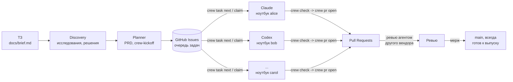

[English](README.md) | **Русский**

# agent-crew

**Нейтральная к вендору среда разработки, где несколько кодинг-агентов (Claude Code, Codex, другие через адаптеры) и люди работают как одна команда над любым проектом, координируясь через GitHub Issues и Pull Requests.**

Люди пишут понятные задачи, агенты на машинах участников берут их из общей очереди, пишут код, проверяют его и сдают на ревью, а инструмент следит, чтобы они не мешали друг другу, не ломали `main` и работали по одним правилам, будь то Claude или GPT. Его обкатали на хакатоне из 4 человек (10-13 ноября 2026, около 200 смерженных PR в открытом репо [employee-feedback](https://github.com/GredesCerber/employee-feedback), тогда ещё под предшественником `hk`); хакатонные функции вынесены в необязательный [режим события](#режим-события).

---

## Зачем

Когда несколько агентов (и людей) делят один репозиторий, каждый раз возникают одни и те же проблемы:

- два агента берут одну задачу, или упавший агент навсегда оставляет задачу «зависшей»;
- код агентов никто не ревьюит, или агент одобряет собственную работу;
- агент «зеленит CI», ослабив тест или поправив конфиг CI;
- у каждого вендора свои файлы инструкций, и правила расходятся;
- `main` сломан именно тогда, когда он нужен рабочим.

agent-crew отвечает на это небольшим протоколом поверх GitHub, который обеспечивается кодом и CI, а не текстом.

## Из чего он состоит

| Часть | Что это | Зачем |
|---|---|---|
| **Правила** | `AGENTS.md`, роли, навыки | Как регламент для нового сотрудника: что делать, когда остановиться, что запрещено |
| **Пульт `crew`** | маленькая программа на Node.js без зависимостей (она же MCP-сервер) | Взять задачу, проверить код, сдать работу: одинаково для всех агентов |
| **Проверки** | GitHub Actions, шаблоны, защита веток | Агент может не послушаться текста, но обойти CI не может |

Всё живёт в **GitHub**: Issues это очередь задач, Pull Requests это сдача работы, Actions это проверки. Отдельного сервера нет. Агенты работают **на машинах участников, на их подписках**.

**Правило языка:** всё, что пишется в GitHub (issues, PR, коммиты, комментарии), и всё, что агенты пишут друг другу, по-английски. С каждым человеком агенты говорят на языке этого человека.

## Как это работает



Жизнь одной задачи:

```
needs-spec ──(человек дописал критерии)──► ready ──(crew task claim)──► claimed ──(crew pr open)──► review ──► done
                                             ▲                             │
                                             └──── аренда истекла / ───────┘
                                                   crew task release
```

## Быстрый старт

**Быстрее всего: одно сообщение агенту.** Агент читает [docs/AGENT-SETUP.md](docs/AGENT-SETUP.md) и разворачивает всё сам. Готовые сообщения для капитана, участника и плана лежат в конце того файла. Команды, которые за ними стоят:

```bash
# капитан: проект, репо на GitHub, приглашения и защита main
crew up --repo owner/name --invite alice,bob

# участник: принять приглашение, клонировать, собрать локальные конфиги агентов
crew up --join owner/name
```

Вручную остаётся то, что агенту нельзя или нечем: вход в аккаунты (`gh auth login`, Claude, Codex) и подтверждение доверия проекту в Codex.

### 1. Установить (один раз на каждой машине)

Нужны Node.js 22+, git, [GitHub CLI](https://cli.github.com/) (`gh auth login`) и хотя бы один агент: [Claude Code](https://code.claude.com) или [Codex CLI](https://github.com/openai/codex).

Инструмент ставится из публичного реестра npm (без токенов):

```bash
npm install -g @gredescerber/agent-crew
```

Команда называется `crew`. Напрямую из GitHub: `npm install -g --allow-git=all github:GredesCerber/agent-crew#vX.Y.Z` (тег нужного релиза) (npm 12+ без флага запрещает установку из git).

Или клонировать и подключить (зависимостей нет; `npm link` только кладёт `crew` в PATH):

```bash
gh repo clone GredesCerber/agent-crew && cd agent-crew && npm link
```

```bash
crew doctor
```

`crew doctor` покажет, чего не хватает.

**Windows:** если PowerShell не запускает `crew` («выполнение сценариев отключено в этой системе»), вызывайте `crew.cmd` (и `npm.cmd`); менять политику не нужно. Запускайте crew из папки проекта: в PowerShell `cd D:\путь\к\проекту` (в cmd нужен `cd /d`).

**Windows:** включите длинные пути в git, иначе он падает на worktree задач и `node_modules`:

```bash
git config --global core.longpaths true
```

### 2. Создать проект (капитан)

```bash
crew up my-product --repo owner/my-product --stack web-node --invite alice,bob --public
```

`crew up` запускает `crew init`, делает первый коммит, создаёт репо на GitHub и пушит, приглашает участников, настраивает защиту `main`, метки и `CREW_HARNESS`. Повторный запуск безопасен: сделанные шаги пропускаются. Хосты агентов выбираются флагом `--hosts claude,codex`.

Или по шагам:

```bash
crew init my-product --stack web-fastapi
cd my-product && git add -A && git commit -m "chore: crew init"
gh repo create owner/my-product --public --source . --push
crew github setup --apply
```

Что появится в `my-product/`:

```
AGENTS.md                ← главные правила для всех агентов
CLAUDE.md                ← одна строка: @AGENTS.md (Claude читает правила оттуда)
crew.config.json         ← зоны, проверки, уровни моделей, MCP
agents/roles/            ← analyst, planner, builder, reviewer, integrator + помощники scout, implementer
agents/skills/           ← crew-workflow, crew-kickoff, crew-review, crew-brief-analysis, crew-discovery
.claude/ .mcp.json       ← сгенерировано для Claude Code (+ плагин ECC)
.codex/ .agents/skills/  ← сгенерировано для Codex
.github/                 ← шаблоны задач и PR, CI-проверки (crew.yml) и правила PR (crew-guard.yml)
contracts/ tests/ docs/  ← контракты API, приёмочные тесты, ТЗ, discovery.md, decisions.md, плейбуки
README.md JOIN.md        ← первая строка говорит новичку, что написать своему агенту; JOIN.md для этого агента
events/                  ← необязательные правила события (окно времени, состав команды)
```

Пресеты стека: `web-fastapi` (React + FastAPI) и `web-node` (React + Node.js). Пресет это **не готовый код**, а список генераторов (`npm create vite`, `uv init`) и проверок; каркас создаёт сам агент.

### 3. Настроить репо на GitHub (`crew github setup`)

Одна команда вместо кликов в Settings (нужны права admin на репо):

```bash
crew github setup           # показать план вызовов gh api, ничего не менять
crew github setup --apply   # выполнить
```

С `--apply` она:

- защищает `main`: только через PR, обязательны зелёные `check` (тесты) и `crew-guard` (правила PR + ревью агента), без force-push. **Ручных одобрений ноль**: человек не «кнопка approve»;
- включает авто-мерж и только обычный merge-коммит (squash и rebase выключены, потому что теряют trailers `Agent`/`Issue`);
- ставит переменную репо `CREW_HARNESS`: спецификацию установки, которую использует CI, по умолчанию `@gredescerber/agent-crew@<версия>` (другая через `--harness`);
- создаёт или обновляет все метки (как `crew labels sync`).

Повторный запуск безопасен. Репо берётся из текущей папки (`gh repo view`) или из `--repo owner/name`; другая ветка через `--branch`.

> **Для защиты веток нужен публичный репо или GitHub Pro/Team.** На бесплатном тарифе приватный репо не может защитить `main`, и `crew github setup --apply` вернёт HTTP 403.

### 4. Подключиться к готовому проекту (участники)

**Проще всего:** когда капитан добавил вас в репо, напишите своему агенту на любом языке: **«Присоединись к разработке owner/name»**. README проекта отправит его в `JOIN.md`: проверка машины, версия crew, закреплённая в репо (`CREW_HARNESS`), `crew up --join` и первая задача. От вас нужен только вход в GitHub, если агент попросит; перезапуск не нужен. Вручную это одна команда:

```bash
crew up --join owner/name
```

Команда принимает приглашение, клонирует репо, настраивает git и запускает `crew adapters build`, который создаёт локальные конфиги агентов (`.mcp.json`, `.codex/config.toml`, навыки, роли). Они зависят от машины и не коммитятся; `crew task claim` копирует их в каждый worktree задачи.

Имя агента в задачах и коммитах это `CREW_AGENT` плюс имя машины (`claude@alice-laptop`), его добавляет `crew`. Вторая сессия на той же машине получает своё имя автоматически от MCP-сервера crew (`claude@alice-laptop#2`); для ревью обе считаются одним агентом, поэтому одобрить друг друга не могут. В терминале вне папки задачи, когда сессий несколько, crew просит пользоваться MCP-инструментами, а не угадывает (`ambiguous_agent`).

### 5. Discovery: исследование до плана (капитан и все)

Новый командный проект начинается в **фазе discovery** (`crew.config.json` → `"phase": "discovery"`): продуктового кода ещё нет, crew-guard пропускает только PR в `docs/`, `spikes/`, `README.md` и `JOIN.md` (в `spikes/` одноразовые эксперименты, которые не становятся кодом продукта). Агент капитана выписывает открытые вопросы ТЗ блоками `crew-research` в `docs/discovery.md`; `crew discover plan --apply` делает из них задачи-исследования для владельцев зон. Каждая заканчивается документом: факты с источниками, допущения помечены, позиция. Споры идут в комментариях к PR и через `crew ask`, вопросы к организаторам через `crew ask --human`, принятые решения в `docs/decisions.md`. PRD пишется из всего этого PR'ом, который ревьюит агент другого вендора. `crew discover status` показывает, что осталось; `crew kickoff --apply` ждёт его и переключает фазу на `build` (скилл `crew-discovery`).

### 6. План: ТЗ -> PRD -> задачи (капитан)

Капитан кладёт ТЗ в `docs/brief.md`, а агент-planner превращает его в `docs/prd.md` (навыки `crew-brief-analysis` и `crew-kickoff`). В PRD есть блок `crew-team` (кто за какую зону отвечает, кто ревьюит) и блоки `crew-task` / `crew-epic`. Дальше:

```bash
crew task lint            # проверить PRD без сети
crew kickoff              # план (dry-run): что создастся
crew kickoff --apply      # создать issues, когда PRD одобрен
```

Подробности в разделе [crew kickoff](#crew-kickoff).

### 7. Запустить агентов

**Claude Code**: откройте папку проекта; он сам прочитает `CLAUDE.md` -> `AGENTS.md` и подключит MCP-сервер `crew`. Затем:

> /loop 10m Work the crew-workflow loop

**Codex**: запустите `codex` в корне проекта и подтвердите доверие проекту (иначе он не прочитает `.codex/config.toml`, который заодно даёт его командам в терминале `CREW_AGENT=codex`). В Codex нет `/loop`, поэтому цикл крутится в чате поверх `crew task next --wait`:

> Work the crew-workflow loop without stopping: run `crew task next --wait 20`, do what its next_actions say, then run it again. Stop after three "no free tasks" answers in a row.

Участники никогда не планируют; `crew kickoff` запускает только капитан.

### Соло: один человек, один агент

`crew init <папка> --solo` (или `crew up ... --solo`) оставляет полезное и убирает командную обвязку: без фазы discovery, без ревью вторым агентом (`review.approvals: 0`), один хост (Claude, если не задан `--hosts`), без передачи капитанства. Проверки CI, правила crew-guard о защищённых файлах и приёмочных тестах и защита `main` остаются; PR сливается, как только они зелёные, а `risk:high` по-прежнему ждёт вас. Задачи: issue с критериями Given/When/Then (`crew task status <n> ready`) или PRD и `crew kickoff`.

## Концепции

### Задачи и аренда
Задача это GitHub issue с метками `status:*`, `area:*`, `tier:*` и `risk:*`. `crew task claim <id>` берёт её: меняется метка, в комментарий пишется маркер аренды, создаются ветка `crew/<id>-...` и отдельный worktree. Аренда длится 45 минут и продлевается активностью (`crew task heartbeat`, маркеры crew в issue или пуш в ветку `crew/<id>-*`). Если агент умер, задача сама возвращается в очередь (GitHub Action проходит каждые 15 минут). `crew task cleanup` убирает worktree закрытых задач без незакоммиченных правок и с работой, уже сохранённой в `main` или на GitHub.

### Зоны и хозяева
Каждая задача относится ровно к одной зоне (`web`, `api`, `infra`, ...). Блок `crew-team` в PRD сопоставляет зоны людям:

````
```crew-team
alice: web, review   # фронтенд + ревьюер
bob: api
```
````

`crew task next` сначала предлагает агенту человека его собственные задачи, потом ничьи, потом чужие зоны («помоги хозяину»). Роль `review` отмечает ревьюеров команды.

### Очередь «сначала ревью»
`crew task next` сначала обслуживает команду, потом себя: свой PR, которому нужны правки, затем вопрос, который вам задал другой агент, затем ответ на ваш вопрос, затем ваша незаконченная задача на этой машине (`resume`, если сессия умерла), затем готовый к мержу PR, затем PR, ждущий вашего ревью, и только потом новая задача. Так работа не копится за ревью.

### Капитан и передача роли
Капитан тот, кто запустил `crew up` (`crew.config.json` → `captain`): только он планирует (`crew kickoff --apply`, `crew discover plan --apply`), решает по идеям и получает вопросы, которым нужен человек. Владелец репо при `crew up` выбирает, можно ли передавать роль: `--handover off` (по умолчанию), `deputies` (только тем, кто в `--deputies`), `team` (любому с правом записи), и по желанию автоматическую подмену первым заместителем, если капитан молчит `--fallback_hours` часов. Капитан передаёт роль `crew captain handoff @логин --hours N` и забирает `crew captain back`; `crew captain` показывает, кто сейчас капитан. Правило меняется потом через `crew captain policy`.

### Идеи и вопросы
Если человек предлагает что-то вне текущей задачи, агент не делает это сам: `crew idea` записывает идею для капитана, а он принимает её задачей `needs-spec` (`crew idea accept`) или отклоняет с причиной. Если агенту нужно что-то из чужой зоны, он спрашивает владельца через `crew ask <зона>`; ответ приходит через `crew task next`. Решения, которые может принять только человек, уходят капитану с `--human`. Ничего не решается «в чате»: всё это issue, которые видят люди.

### Статус команды без LLM
`crew digest` (CI держит его в закреплённом issue, обновляя каждые 15 минут) и `crew board` (локальная страница с панелью капитана) показывают, что ждёт человека, зависшие аренды, PR в ожидании, открытые вопросы, идеи, кто простаивает, у кого есть доступ, но нет зоны, фазу и исследования сверх бюджета. Держать агента, который опрашивает репо, не нужно.

### Перекрёстное ревью и `crew-guard`
Код Claude ревьюит Codex и наоборот: разные модели ловят разные ошибки. `crew-guard` это коммит-статус на каждом PR:

- `failure`, если PR меняет правила агентов или CI (`crew.config.json`, `.github/**`, `AGENTS.md`, `CLAUDE.md`, `agents/**`, `events/**`). Агентам это нельзя совсем; правила меняет мейнтейнер;
- `failure`, если PR меняет или удаляет **существующий** приёмочный тест, а его задача этого не разрешает (поле `changes_acceptance` задачи в PRD). Новые тесты добавлять можно;
- `failure`, если ревьюер попросил правки; `pending`, пока ждёт ревью; `success`, когда ревью сделал **другой агент** на текущем коммите (`crew pr review <n> --verdict approve`). Другая сессия того же агента на той же машине (`claude@pc#2`), агент, написавший коммиты, и боты не засчитываются. PR с `risk:high` не сливается сам: после ревью его сливает человек (или `crew merge-ready` в CI);
- `failure` в фазе discovery, если PR трогает что-то кроме `docs/`, `spikes/`, `README.md` и `JOIN.md` (`discovery_phase`; переименование проверяется с обеих сторон), а после неё, если PR меняет `spikes/` или выносит из него файлы (`spike_in_build`);
- `failure`, если PR открыт crew старше версии, закреплённой в `CREW_HARNESS` (`outdated_crew`): обновите crew и запустите `crew pr open` ещё раз;
- человек может снять «бумажные» правила (`closes`, `agent_trailer`, `not_crew_pr`) для одного коммита PR, сделанного без crew, через `crew pr waive`; защищённые файлы, приёмочные тесты и само ревью снять нельзя;
- для `risk:high` тесты и код пишут **разные агенты**: задача на тесты (`tests_for`) кладёт их в `tests/pending/<T>/`, а основная задача обязана перенести их в `tests/acceptance/` без единой правки (иначе `failure`); `crew task claim` не даёт автору тестов взять код;
- кто ревьюит, задаётся в `crew.config.json -> review`: по умолчанию агент другого вендора, а если такого нет 30 минут, любой другой агент. Команда только с Claude использует `"require": "other-agent"` или `"hosts": ["claude"]`;
- workflow `crew-guard.yml` берётся из `main`, а не из ветки PR (`pull_request_target`), и код PR не запускает, поэтому PR не может ослабить проверку сам себе;
- на PR `crew check` в CI использует `crew.config.json` из base-коммита, а не из ветки PR; на push в `main` использует свой.

`crew guard --pr <n>` покажет то же самое локально: почему PR не мержится.

### Защищённый `main`
`crew github setup --apply` делает `main` доступным только через PR с обязательными `check` и `crew-guard`. Люди не одобряют каждый PR: они тестируют работающий продукт и пишут фидбек, а planner превращает его в задачи. См. замечание о публичных репо выше.

**Аварийная остановка:** создайте issue с меткой `crew:pause`; агенты закончат текущий шаг и остановятся. Это в коде: пока такой issue открыт, `crew task next` и `crew task claim` возвращают ошибку `paused`.

## Команды `crew`

| Команда | Что делает |
|---|---|
| `crew task next [--area web] [--tier low] [--wait 20]` | следующее дело для вас: свой PR на правки, вопрос, на который надо ответить, или ответ на ваш, ваша незаконченная задача (`resume`), PR на мерж, ревью или свободная задача под вашу зону и уровень модели; с `--wait N` в простое опрашивает раз в минуту до N минут (цикл в чате для Codex) |
| `crew task claim <id>` | взять задачу: метка, аренда, ветка `crew/<id>-...`, отдельный worktree |
| `crew check` | прогнать линтер/типы/тесты из `crew.config.json`; коротко про ошибки, полный лог в `.crew/logs/`; у шага есть `timeout_s` (по умолчанию 600), зависший шаг убивается и даёт `ci_red` |
| `crew commit -m "feat: ..."` | коммит с trailers `Agent` и `Issue` |
| `crew pr open` | открыть PR (только после зелёного check), задача -> `review` |
| `crew pr review <n> --verdict approve\|changes --note "..."` | вердикт ревьюера-агента (засчитывается `crew-guard`; своё ревью нельзя) |
| `crew guard --pr <n>` | почему PR не мержится: правила, приёмочные тесты, ревью (CI ставит статус с `--report`) |
| `crew task status <id> blocked --note "..."` | сменить статус и оставить хендофф |
| `crew task release <id>` / `heartbeat <id>` | вернуть задачу / продлить аренду (только свою; чужую человек с `--force`) |
| `crew shots before\|after --url <страница> [--name <экран>]` | скриншот «до» и «после» (Playwright) для задачи, меняющей интерфейс; `crew pr open` показывает их таблицей Before / After |
| `crew board [--port 4747]` | локальная доска задач в браузере: панель капитана (счётчики, что ждёт человека, идеи с кнопками Принять / Отклонить), очередь по статусам, ждущие PR; вручную назначить исполнителя, статус и приоритет (без токенов агентов) |
| `crew upgrade [--apply]` | обновить существующий проект до установленной версии (правила, навыки, workflows, конфиги агентов; переводит проекты с hk); `--apply` открывает PR |
| `crew ask <зона\|@логин> --text "..." [--task N] [--human]` | вопрос хозяину зоны; вопрос — это issue (`crew:question`), ответ приходит в `crew task next` |
| `crew idea "..." [--original "..."] [--from_person логин] [--task N]` | записать идею, которую человек предложил вне текущей задачи; капитан видит её в `crew task next`, сводке и на доске |
| `crew idea list` / `crew idea accept <n> [--area a] [--priority high\|low]` / `crew idea reject <n> --reason "..."` | капитан: решить по идеям; accept превращает идею в задачу `needs-spec` |
| `crew captain` / `crew captain handoff @логин [--hours N]` / `crew captain back` / `crew captain policy --mode off\|deputies\|team [--deputies a,b] [--fallback_hours N]` | кто сейчас капитан; передать роль на время (если проект разрешает); само правило, которое владелец репо выбирает при `crew up` |
| `crew discover plan [--apply]` / `crew discover status` | фаза discovery: вопросы из `docs/discovery.md` становятся задачами-исследованиями (капитан); status показывает, что осталось до `crew kickoff --apply` |
| `crew inbox [--ack N]` / `crew answer N --text "..." [--human]` | вопросы к тебе и ответы на твои / ответить и закрыть (или передать человеку с `needs-human`) |
| `crew pr waive <n> --rule <r> --reason "..."` | только человек: снять «бумажное» правило crew-guard (closes, agent_trailer, not_crew_pr) для текущего коммита PR, сделанного без crew; ревью всё равно нужно |
| `crew pr logs <n>` | почему PR красный: упавший шаг из лога CI, без браузера |
| `crew merge-ready [--dry_run]` | смержить готовые PR (ревью, зелёные check и crew-guard), которые не сольются сами; запускает job в CI по расписанию, сессия агента не нужна |
| `crew digest [--post]` | сводка команды без LLM: что ждёт человека, зависшие аренды, PR в ожидании, открытые вопросы, идеи, кто простаивает, новички без зоны, фаза, исследования сверх бюджета, кто сейчас капитан; job в CI по расписанию держит её в закреплённом issue |
| `crew task cleanup [--dry_run]` | убрать worktree закрытых задач (только без незакоммиченных правок и с работой, уже сохранённой в main или на GitHub) |
| `crew task lint` | проверить `docs/prd.md` без сети: все ошибки сразу (строка, id, правило) |
| `crew task sweep` / `crew task promote` | вернуть просроченные аренды в очередь / перевести `waiting` в `ready`, когда зависимости закрыты (запускает CI) |
| `crew kickoff [--apply]` | создать issues и эпики из одобренного PRD (по умолчанию dry-run) |
| `crew status` | что в очереди, кто что делает, что заблокировано |
| `crew worker --host codex` | безголовый цикл, который берёт задачи и запускает агента на каждую (только для людей) |
| `crew metrics`, `crew eval` | метрики по агентам из журнала / сравнение агентов на эталонных задачах |
| `crew compliance check` / `disclosure` | режим события: проверка правил / файл раскрытия для сабмита |
| `crew up`, `crew init`, `crew adapters build`, `crew labels sync`, `crew doctor` | настройка (для людей; `crew up` делает всё сразу, см. docs/AGENT-SETUP.md) |
| `crew github setup [--apply]` | защита `main`, переменная `CREW_HARNESS`, метки: план, а с `--apply` выполнить (для людей) |
| `crew mcp` | MCP-сервер: те же команды как инструменты `crew_*` для агентов |

MCP-сервер запущен в корне проекта, поэтому `crew_check`, `crew_commit`, `crew_pr_open`, `crew_task_claim` и `crew_compliance_check` принимают необязательный `cwd`: абсолютный путь worktree из `crew_task_claim -> artifacts.worktree`. Без него инструменты работают с корнем, а не с веткой задачи.

Каждая команда отвечает в одной форме, чтобы агенту не приходилось гадать:

```json
{
  "schema": "crew/v1",
  "status": "error",
  "summary": "Failed: api-test",
  "next_actions": ["fix it and run crew check again"],
  "artifacts": { "log": ".crew/logs/check-2026-12-05T12-00-00.txt" },
  "error": {
    "code": "ci_red",
    "cause_hint": "FAILED tests/test_auth.py::test_login - assert 401 == 200",
    "retry": "fix it and run crew check again",
    "stop_when": "the same error 3 times in a row -> crew task status <id> blocked"
  }
}
```

(Тексты в ответах команд английские, как и всё, что пишется в GitHub и между агентами.)

## crew kickoff

Planner (навык `crew-kickoff`) читает `docs/brief.md`, `docs/brief-analysis.md`, исследования в `docs/research/` и `docs/decisions.md` и пишет только `docs/prd.md` с блоками `crew-team`, `crew-task` и `crew-epic` ([формат](skills/crew-kickoff/task-format.md)). Issues создаёт код:

```bash
crew task lint            # проверить PRD без сети: все ошибки сразу (строка, id, правило)
crew kickoff              # план (dry-run): что создастся, статусы, порядок
crew kickoff --apply      # создать задачи и эпики, только если PRD одобрен
```

- **Одобрение** это первая строка PRD `<!-- crew:prd status: approved by: <login> at: <ISO> -->`. Без неё `--apply` отвечает `plan_not_approved`. Применять может только капитан (или тот, кто сейчас капитан после передачи роли). В фазе discovery `--apply` ещё ждёт `crew discover status` (`discovery_not_done`; `--skip_discovery` это решение человека в обход) и затем переключает фазу на `build`. `--apply` также отказывает с `team_not_collaborator`, если в блоке `crew-team` указан человек, который не является участником репо.
- **Каркас**: первый блок (`skeleton: true`, `tier/risk: high`); остальные задачи неявно ждут его. Задача с зависимостями создаётся в `status:waiting` («после #N»), без них в `ready`, а `ready: false` даёт `needs-spec`.
- **waiting -> ready** делает `crew task promote`: job `promote` в `crew.yml` при закрытии issue и `crew task sweep` по расписанию.
- **Риск** `low | med | high` (по умолчанию `med`), одна зона на задачу, критерии приёмки `Given/When/Then` (русские `Дано/Когда/Тогда` тоже принимаются), `req: [R1]` превращается в «Требования ТЗ» в issue.
- **Повтор безопасен**: задачи находятся по маркеру `crew:task` в теле, создаются только новые; изменённые или удалённые блоки дают лишь предупреждения. Между вызовами `gh issue create` пауза 1 с, при rate limit повтор через 10/30/60 с; сбой посередине это `kickoff_partial`, просто запустите снова.

## crew worker

Агент может крутить очередь и без интерфейса: человек запускает воркер и занимается своим.

```bash
crew worker --host codex --area api --tier mid       # Codex берёт задачи зоны api
crew worker --host claude --max-tasks 3 --dry-run    # показать, что взял бы, ничего не трогая
```

Цикл: `crew task next` -> `crew task claim <id>` -> агент запускается в worktree задачи (`CREW_AGENT=<host>/<model>`) с коротким промптом («работай только над #id по crew-workflow; закончи `crew pr open` или `crew task status blocked/needs-spec`») -> воркер смотрит статус issue -> следующая задача. **Каждая задача это новый процесс агента**, то есть чистый контекст на границе фазы.

| Флаг | По умолчанию | Что делает |
|---|---|---|
| `--host claude\|codex` | нет | какой агент запускать (`adapter.headless()`) |
| `--area`, `--tier` | любая, `high` | как у `crew task next`; модель берётся из `crew.config.json -> tiers` |
| `--model` | из tier | конкретная модель |
| `--max-tasks` | 5 | сколько задач взять за запуск |
| `--max-failures` | 3 | стоп после N неудач подряд |
| `--task-timeout-min` | 60 | убить агента (всё дерево процессов) на задаче |
| `--wait` | выкл | очередь пуста: опрос раз в 5 мин вместо выхода |
| `--dry-run` | выкл | только показать задачу и команду запуска |

- **Успех**: после выхода агента задача в `review`/`done`. `blocked`/`needs-spec` это хендофф, а не неудача.
- **Неудача**: задача осталась `claimed` (агент упал, вышел молча, таймаут): воркер делает `crew task release` с заметкой и ссылкой на лог.
- **Стоп**: пауза (`crew:pause`), пустая очередь, лимит задач, N неудач подряд, 3 конфликта claim подряд, агент не запускается.
- Прогресс по задачам идёт в stderr, вывод агента в `.crew/logs/worker-<id>-*.log`, итог это ответ `crew/v1` с `artifacts: { done, failed, blocked, stopped_reason }`.
- Codex запускается как `codex exec --json -s workspace-write -c sandbox_workspace_write.network_access=true -C <worktree> --add-dir <.git репо> -` (промпт в stdin). Claude как `claude -p <промпт> --output-format json --permission-mode acceptEdits` с явным списком `--allowedTools`.
- Только для людей: в MCP воркер не попадает.

## Метрики и eval

Без данных нельзя понять, стал ли инструмент лучше, поэтому каждая команда `crew` пишет событие в журнал.

**Журнал.** После каждой команды в `.crew/metrics.jsonl` (в корне основного репо, общий для всех worktree) дописывается строка:

```json
{"command":"check","issue":12,"agent":"codex/gpt-5","status":"error","error_code":"ci_red","duration_ms":8123,"at":"2026-12-05T12:00:00.000Z"}
```

Номер задачи берётся из аргумента `id`, из `artifacts.issue` или из ветки `crew/<id>-...`. Пишется только в проекте с `crew.config.json`, и запись никогда не ломает команду. Отключить: `CREW_METRICS=off`.

**Сводка:** `crew metrics [--agent codex] [--since 2d]` показывает по каждому агенту:

| Метрика | Как считается |
|---|---|
| доведено (completion rate) | успешные `pr open` / успешные `task claim` |
| check на задачу (retries) | среднее число запусков `crew check` на задачу |
| claim -> PR | медиана времени от claim до первого успешного `pr open` по той же задаче |
| частые ошибки | топ-5 `error.code` по всем событиям |

`--agent codex` ловит и `codex/gpt-5`; `--since` принимает дату, ISO-время или `30m` / `6h` / `2d`.

**Eval.** `crew eval` сравнивает агентов на одних и тех же эталонных задачах. Он нужен, чтобы понять, не ухудшила ли правка `AGENTS.md`, навыков или ролей работу агентов, и какую модель на какой уровень ставить:

```bash
crew eval --dry-run                              # проверить задачи и показать план, агенты не запускаются
crew eval --agents claude,codex --runs 3         # задачи x агенты x прогоны
crew eval --agents claude:opus,claude:sonnet --task fix-off-by-one
```

Каждый прогон идёт в свежей временной копии репо-фикстуры (на закреплённом `commit`, если он задан): агент запускается через `headless()` своего адаптера, потом детерминированные судьи (`command` для тестов/сборки, `grep` для шаблона в файлах) решают pass/fail. Отчёт это таблица и `artifacts.results`: **pass@1**, **pass@k**, **стабильность (consistency)**, среднее время и стоимость (если агент её сообщает) по каждому агенту и задаче; полный отчёт в `.crew/evals/`.

Задачи это `evals/tasks/*.json` в формате, близком к [agent-eval](https://github.com/joaquinhuigomez/agent-eval) (JSON вместо YAML, без зависимостей), фикстура это `evals/fixtures/mini-app/`. Формат, соответствие agent-eval и как добавить задачу описаны в [`evals/README.md`](evals/README.md). В CI (`.github/workflows/eval.yml`) на PR в `templates/product/AGENTS.md`, `skills/`, `roles/`, `evals/` гоняется `--dry-run`; настоящий прогон запускается вручную, потому что агентам нужны ключи API.

## ECC и необязательные MCP-серверы

- **[ECC](https://github.com/affaan-m/ECC)** включается для Claude Code автоматически (`.claude/settings.json`). Какие навыки ECC брать по ролям, описано в [`ecc/profile.json`](ecc/profile.json). ECC это ускоритель, а не зависимость: протокол `crew` работает и без него, поэтому Codex работает наравне.
- **Необязательные MCP-серверы** лежат в `crew.config.json -> mcp` и по умолчанию выключены. Ключи только из переменных окружения, никогда из файлов:
  - `context7`: свежая документация библиотек и API (включать первым);
  - `perplexity`: глубокий веб-поиск для kickoff и питчей (`PERPLEXITY_API_KEY`; имя пакета проверить перед включением);
  - `playwright`: браузер для сквозных тестов демо-пути.

  После изменения: `crew adapters build`.

## Режим события

Сам инструмент нейтрален; для хакатонов и других событий с ограничением по времени есть необязательный режим на основе `events/event.json` (скопируйте его из `event.example.json` и пропишите `"event": "events/event.json"` в `crew.config.json`; `crew up --start ... --end ...` делает это за вас):

- CI проверяет, что нет коммитов до старта и после конца, что PR идут только от `team_members` и что ИИ используется только если разрешён;
- `crew compliance check` запускает те же проверки локально; `crew compliance disclosure` пишет `DISCLOSURE.md`: какие инструменты и агенты использовались и сколько коммитов от кого;
- репо продукта создаётся пустым на старте (`crew init`), и во время события в него коммитят только участники команды;
- плейбуки продукта в `templates/product/docs/playbooks/` описывают расписание дня такого события ([`timeline.md`](templates/product/docs/playbooks/timeline.md)), чек-лист перед событием ([`preflight.md`](templates/product/docs/playbooks/preflight.md)) и правила ведения задач: статусы, метки, Definition of Ready, кто что делает ([`issues.md`](templates/product/docs/playbooks/issues.md)).

Правила каждого события всё равно читайте заново: у организаторов они разные. Без `events/event.json` ничего из этого не действует.

## Как расширять

| Хочу | Что сделать |
|---|---|
| Новую команду `crew` | файл в `src/commands/` + строка в `src/core/registry.js`; она появится и в CLI, и в MCP |
| Поддержку нового агента (Gemini, Cursor, ...) | `adapters/<host>/adapter.js` с `generate()` и `headless()`, добавить хост в `hosts` |
| Новый стек | `templates/stacks/<name>.json`: зоны, генераторы, проверки |
| Новую роль или навык | `roles/<name>.md` или `skills/<name>/SKILL.md` (формат Agent Skills) |

Подробности: [`docs/ARCHITECTURE.md`](docs/ARCHITECTURE.md) (на английском). Какие готовые решения мы изучили и чем отличаемся: [`docs/RESEARCH.md`](docs/RESEARCH.md).

## Ограничения

- **Для защиты веток нужен публичный репо или GitHub Pro/Team.** Приватный репо на бесплатном тарифе GitHub не может защитить `main`; `crew github setup --apply` вернёт HTTP 403.
- **`crew-guard` ловит лень и ошибки, а не злой умысел.** Агенты работают под аккаунтами людей, поэтому агент, который *намеренно* подделает маркер `crew:review` от чужого имени или вмержит с `--admin`, технически не остановлен; это запрещено в `AGENTS.md` и видно в истории PR. Ослабить тест, «починить» CI или одобрить себя случайно не выйдет.
- **Headless-запуск Claude** для `crew worker` использует `claude -p` с `--permission-mode acceptEdits` и явным списком `--allowedTools` (правки файлов, `npm`/`node`/`uv`, чтение `git`, `crew`); флаги взяты из документации Claude Code и проверялись вживую меньше, чем Codex. Сначала попробуйте одну задачу на своей машине. Headless-запуск Codex (`codex exec`) проверен вживую на codex-cli 0.166: инструменты `crew` вызываются без подтверждения (`default_tools_approval_mode = "approve"` только для сервера `crew`).
- **Пакет Perplexity MCP не выбран:** в `templates/mcp.optional.json` стоит заглушка `VERIFY-PACKAGE-NAME-BEFORE-ENABLING`; включайте только после проверки имени пакета.
- **Приватность ваших правил:** `crew init` копирует в репо продукта правила, роли, навыки и workflow, поэтому если этот репо публичный, эти файлы видны всем.
- **Имя Codex в терминале:** `.codex/config.toml` проекта задаёт `CREW_AGENT=codex` для команд Codex в терминале через `[shell_environment_policy]`; ключ есть в codex-cli 0.166, но в живой сессии Codex это ещё не проверялось.
- Коммит-статус `crew-guard`, поставленный `GITHUB_TOKEN`, засчитывается с `app_id` GitHub Actions; если у вас иначе, в защите ветки поставьте «any source».

## Роадмап

- [x] **v0**: `crew` (CLI + MCP), AGENTS.md, роли и навыки, адаптеры Claude Code и Codex, шаблоны GitHub, CI, compliance
- [x] **v1**: MCP в worktree задачи (`cwd`), аренда по коммитам, `crew:pause` в коде, таймауты `crew check`, защита конфигов в CI, `crew github setup`, `crew worker`, `crew metrics`, `crew eval`, `crew kickoff` с блоком `crew-team`, `crew up`, очередь «сначала ревью»; см. [`docs/ROADMAP-v1.md`](docs/ROADMAP-v1.md)
- [x] **v0.6–0.9**: детерминированный мерж в CI (`crew merge-ready`), сводка команды без LLM, локальная доска, вопросы между агентами, идеи, передача капитанства, свои имена у сессий агентов, фаза discovery, подключение одним сообщением, соло-режим
- [ ] **0.10**: блокировки сессий по репозиторию, продолжение работы после смены имени сессии, pre-release версии, живая проверка Codex и headless-флагов Claude, `crew worker --budget`
- [ ] **0.11 и дальше**: ночные проверки, независимое ревью перед каждым релизом, адаптеры для Gemini и Cursor, действия, которые может сделать только человек

Подробно, зачем каждый пункт и когда он считается сделанным: [`docs/ROADMAP.md`](docs/ROADMAP.md).

## Разработка самого инструмента

```bash
npm test
```

Правила для контрибьюторов (и их агентов) лежат в [`AGENTS.md`](AGENTS.md) в корне этого репо.

## Лицензия

Apache-2.0. См. [LICENSE](LICENSE).
